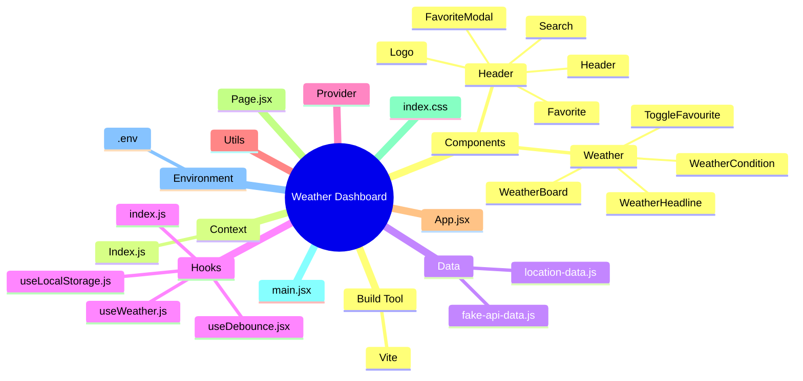

# 🌦️ Weather Dashboard

[](https://react.dev/)
[](https://vite.dev/)
[](https://developer.mozilla.org/en-US/docs/Web/JavaScript)
[](https://eslint.org/)
[](https://vercel.com/)

> A responsive weather dashboard for searching locations and viewing weather conditions in a clear, visual interface.

---

## 📌 Table of Contents

- [About the Project](#-about-the-project)
- [Mind Map](#-mind-map)
- [Folder Structure](#-folder-structure)
- [Preview / Demo](#-preview--demo)
- [Features](#-features)
- [Tech Stack](#-tech-stack)
- [Installation](#-installation)
- [Usage](#-usage)
- [Production Build](#-production-build)
- [Deployment](#-deployment)
- [Available Scripts](#-available-scripts)
- [Environment Variables](#-environment-variables)
- [Contributing](#-contributing)
- [License](#-license)
- [Author](#-author)
- [Credits / References](#-credits--references)

---

## 📖 About the Project

**Weather Dashboard** is a React-based weather application that lets users search for a location by entering its name and view the corresponding weather information in a dashboard-style interface.

The displayed weather panel includes the current temperature, location name, “feels like” temperature, climate condition, maximum and minimum temperature, humidity, cloudiness, and wind speed. The interface also includes location search and favourite-location controls.

The project uses a component-based structure with separate folders for header components, weather components, context, data, hooks, providers, and utilities.

---

## 🧠 Mind Map



---

## 📂 Folder Structure

The following structure is based on the project-tree screenshot provided.

```text
Weather Dashboard/
│
├── public/
│
├── src/
│   ├── assets/
│   │
│   ├── Components/
│   │   ├── Header/
│   │   │   ├── Favorite.jsx
│   │   │   ├── FavoriteModal.jsx
│   │   │   ├── Header.jsx
│   │   │   ├── Logo.jsx
│   │   │   └── Search.jsx
│   │   │
│   │   └── Weather/
│   │       ├── ToggleFavourite.jsx
│   │       ├── WeatherBoard.jsx
│   │       ├── WeatherCondition.jsx
│   │       └── WeatherHeadline.jsx
│   │
│   ├── Context/
│   │   └── Index.js
│   │
│   ├── data/
│   │   ├── fake-api-data.js
│   │   └── location-data.js
│   │
│   ├── Hooks/
│   │   ├── index.js
│   │   ├── useDebounce.jsx
│   │   ├── useLocalStorage.js
│   │   └── useWeather.js
│   │
│   ├── Provider/
│   │
│   ├── utils/
│   │
│   ├── App.jsx
│   ├── index.css
│   ├── main.jsx
│   └── Page.jsx
│
├── .env
├── .gitignore
├── eslint.config.js
├── index.html
├── package-lock.json
├── package.json
├── vite.config.js
└── README.md
```

> The `Provider` and `utils` folders are visible in the project tree, but their inner files are collapsed in the screenshot, so they are shown without guessed filenames.

---

## 🖼️ Preview / Demo

### Live Demo

**Vercel:** Add your deployed Vercel URL here.

### Screenshot

To add a screenshot, save it in the repository, for example:

```text
docs/screenshots/weather-dashboard.png
```

Then include:

```markdown

```

---

## ✨ Features

- 🔎 Search for weather by location name.
- 🌡️ Display the current temperature for the selected location.
- 📍 Show the selected location name.
- 🌤️ Display the climate or weather condition.
- 🌡️ Show feels-like, maximum, and minimum temperatures.
- 💧 Display humidity.
- ☁️ Display cloudiness.
- 💨 Display wind speed.
- ❤️ Add or remove locations from favourites.
- 📋 View favourite locations through the favourites interface.
- 🧩 Reusable React components.
- 🪝 Dedicated hooks for weather-related and reusable logic.
- 💾 Local-storage hook for browser-side persistence.
- ⏱️ Debounce hook for delaying rapidly repeated actions such as search input.
- ⚡ Vite development and production build workflow.

> The exact data source and API behaviour depend on the implementation configured in the project. The repository tree also includes `fake-api-data.js` and `location-data.js`.

---

## 🛠️ Tech Stack

| Technology           | Purpose                                             |
| -------------------- | --------------------------------------------------- |
| **React**            | Building the user interface                         |
| **Vite**             | Development server and production build             |
| **JavaScript / JSX** | Application logic and components                    |
| **CSS**              | Application styling                                 |
| **React Context**    | Shared application state                            |
| **Custom Hooks**     | Reusable weather, debounce, and local-storage logic |
| **ESLint**           | Code quality and linting                            |
| **Git & GitHub**     | Version control and source hosting                  |
| **Vercel**           | Deployment platform                                 |

---

## ⚙️ Installation

### Prerequisites

- Node.js
- npm
- Git

Check installed versions:

```bash
node -v
npm -v
git --version
```

### 1. Clone the Repository

Replace the placeholder with your repository URL:

```bash
git clone YOUR_GITHUB_REPOSITORY_URL
```

### 2. Navigate to the Project Directory

```bash
cd weather-dashboard
```

> Use the actual local folder name if it is different.

### 3. Install Dependencies

```bash
npm install
```

### 4. Configure Environment Variables

The project tree contains a `.env` file. Check the source code to confirm which variables are required.

If an API key or endpoint is required, add the corresponding variable to `.env` using the exact name expected by the code. Vite client-side variables generally need the `VITE_` prefix to be exposed to frontend code.

> Never commit private API keys or secrets to GitHub. If `.env` contains secrets, ensure it is ignored by Git and provide a safe `.env.example` file instead.

### 5. Start the Development Server

```bash
npm run dev
```

Open the local URL printed in your terminal, usually:

```text
http://localhost:5173
```

---

## ▶️ Usage

1. Open Weather Dashboard in your browser.
2. Enter a place or location name in the **Search Location** field.
3. Submit the search using the search control.
4. Review the weather dashboard for the selected location.
5. Check the temperature, feels-like temperature, climate condition, maximum and minimum temperatures, humidity, cloudiness, and wind speed.
6. Use the favourite control to add or remove the displayed location.
7. Open **Favourite Locations** to access saved locations, where supported by the current implementation.

---

## 🏗️ Production Build

Create an optimized production build:

```bash
npm run build
```

Vite will generate production files inside:

```text
dist/
```

Preview the production build locally:

```bash
npm run preview
```

---

## 🚀 Deployment

The project can be deployed to **Vercel** as a Vite application.

### Recommended Vercel Settings

| Setting               | Value                                        |
| --------------------- | -------------------------------------------- |
| Framework Preset      | Vite                                         |
| Build Command         | `npm run build`                              |
| Output Directory      | `dist`                                       |
| Install Command       | `npm install`                                |
| Environment Variables | Configure only those required by the project |

### Deployment Steps

1. Push the project to GitHub.
2. Sign in to Vercel.
3. Select **Add New → Project**.
4. Import the GitHub repository.
5. Confirm the Vite framework preset.
6. Set the build command to `npm run build`.
7. Set the output directory to `dist`.
8. Add any required environment variables in Vercel Project Settings.
9. Click **Deploy**.

---

## 🔧 Available Scripts

| Command           | Description                                 |
| ----------------- | ------------------------------------------- |
| `npm install`     | Install project dependencies                |
| `npm run dev`     | Start the Vite development server           |
| `npm run build`   | Build the production application            |
| `npm run preview` | Preview the production build                |
| `npm run lint`    | Run ESLint, if configured in `package.json` |

---

## 🌐 Environment Variables

The project tree shows a `.env` file, but its contents and required variable names are not visible in the screenshot.

- Check the code for `import.meta.env` references.
- Add the required variable names and values to your local `.env`.
- Configure the same required variables in Vercel before deployment.
- Keep `.env` out of version control if it contains credentials.
- Consider committing a `.env.example` file with placeholder values only.

Example format (replace with the actual variables used by the project):

```env
VITE_WEATHER_API_KEY=your_api_key_here
```

> This example is illustrative only. Use the exact variable name expected by your application code.

---

## 🧪 Development Checks

Before submitting changes, run:

```bash
npm run lint
npm run build
```

If the lint script is not defined in `package.json`, check the available scripts in `package.json`.

---

## 🤝 Contributing

Contributions, bug reports, and improvements are welcome.

### Contribution Steps

1. Fork the repository.
2. Clone your fork.
3. Create a feature branch:

```bash
git checkout -b feature/your-feature-name
```

4. Make your changes.
5. Run the application locally:

```bash
npm run dev
```

6. Run linting and build checks:

```bash
npm run lint
npm run build
```

7. Commit your changes:

```bash
git add .
git commit -m "Add: describe your change"
```

8. Push your branch:

```bash
git push origin feature/your-feature-name
```

9. Open a Pull Request describing the change.

### Suggested Commit Messages

```text
Add: new feature
Fix: search or display issue
Update: weather dashboard UI
Refactor: component or hook logic
Style: responsive layout improvements
Docs: update README
```

---

## 📄 License

No specific open-source license is confirmed by the provided project screenshots.

If you intend to publish or distribute this project as open source, add a `LICENSE` file and specify the license terms. Until then, do not assume that the project is released under the MIT License or another open-source license.

---

## 📚 Credits / References

- **React** — https://react.dev/
- **Vite** — https://vite.dev/
- **MDN Web Docs** — https://developer.mozilla.org/
- **ESLint** — https://eslint.org/
- **GitHub** — https://github.com/
- **Vercel** — https://vercel.com/

- **Project Credit**
  Project: Weather Dashboard
  Type: React + Vite Frontend Project
  Purpose: Real-time weather forecasting, geolocation handling, and favorite locations management

📌 Project Status
Status: Active Development 🚧

The project structure and UI may continue to evolve as new components, features, and improvements are added.

⭐ Support: https://www.linkedin.com/in/sohantalukder68/

👨‍💻 Author: Dev Sohan GitHub: https://github.com/Sohan68/ If you find this project useful, consider giving the repository a ⭐ on GitHub.

Made with ❤️ using React + Vite
⭐ If you find this project useful, consider giving the repository a star.

**Built with ❤️ using React + Vite**
